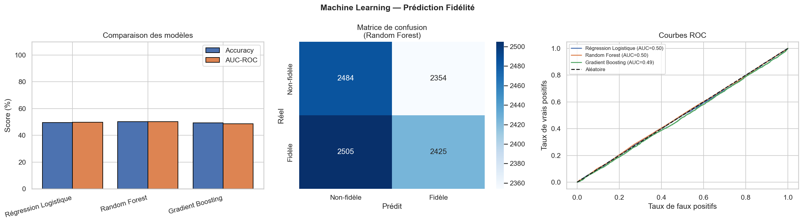

# Analyse des clients Walmart

Analyse en Python d'un jeu de données d'achats : profil du client (âge, genre, ville), produit et catégorie, montant, mode de paiement, remise, note et fidélité (`Repeat_Customer`).

## Analyse (`analyse/walmart_analyse.py`)

- Nettoyage des données et repérage des valeurs aberrantes.
- Trois questions métier : qui sont les meilleurs clients, pourquoi certains ne reviennent pas et quels sont les meilleurs produits.
- Prédiction de la fidélité avec une régression logistique, une forêt aléatoire et du gradient boosting, évalués avec l'exactitude et l'AUC ROC.
- Segmentation des clients par K-means (méthode du coude et score de silhouette), visualisée en ACP.

Les graphiques produits par le script sont dans `figures/`.



## Tableau de bord (`dashboard/app.py`)

Application Streamlit qui présente les indicateurs, la segmentation et des modèles de fidélité et de départ. Un modèle d'apprentissage profond s'ajoute si TensorFlow est installé.

## Exécution

Le fichier de données `Walmart_customer_purchases.csv` n'est pas inclus.

```bash
pip install -r requirements.txt

# analyse : placer le CSV dans data/, puis depuis la racine du dépôt
python analyse/walmart_analyse.py

# tableau de bord : placer le CSV dans dashboard/
cd dashboard
streamlit run app.py
```

---

Alimou Diallo · [LinkedIn](https://www.linkedin.com/in/alimou-diallo-883022bb)
